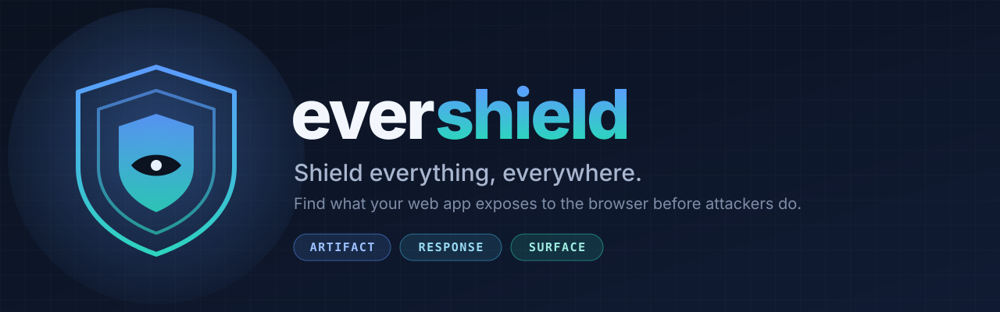

<p align="center">
  
</p>

# evershield

**Shield everything, everywhere.** Find what your web app exposes to the
browser before attackers do.

> Status: pre-release. All three layers work: built-artifact scan,
> privilege-differential response audit, and rendered-surface audit. Follow
> the [roadmap](docs/design.md#roadmap) or open an issue to help shape it.

## Why

Everything a browser receives is public: bundles, source maps, API responses,
the rendered DOM. Reverse-engineering tools now read all of it automatically,
and they look like ordinary visitors, so you cannot block them. The only
defence that works is to control what you ship.

Teams leak in three recurring ways, and evershield checks all three before
deploy:

| Layer | What leaks | Example |
|---|---|---|
| **Artifact** | keys, internal URLs, prompts, source maps in the build | an LLM system prompt shipped as a string constant |
| **Response** | higher-tier data in lower-tier API responses | "Pro only" metrics present in every free user's JSON |
| **Surface** | data hidden by CSS instead of withheld by the server | a blurred paywall with the real numbers in the DOM |

Secret scanners look at your repository. evershield looks at what your users
actually get.

## Quick start

```bash
# scan a built artifact directory
npx evershield scan ./dist            # Vite, CRA, Astro, static sites, …
npx evershield scan ./.next           # Next.js: only browser-facing files are scanned

# machine-readable output and a stricter gate for CI
npx evershield scan ./dist --format json --fail-on medium --min-confidence low

# SARIF for code scanning, written to a file
npx evershield scan ./dist --format sarif --output evershield.sarif

# mobile and desktop app packages: everything inside ships to the device
npx evershield scan app-release.apk   # Android (.apk, .aab), incl. Hermes bytecode and DEX strings
npx evershield scan MyApp.ipa         # iOS: main.jsbundle and the app executable's strings
npx evershield scan app.asar          # Electron
npx evershield scan ./dist            # an Expo / React Native export (*.hbc, *.bundle)
```

Exit code `0` means nothing blocking, `1` means findings at or above the
gate (default: severity ≥ high **and** confidence ≥ medium), `2` means a
usage or runtime error. Matched values are never printed in full.

What layer 1 catches today, with the reasoning behind each severity and
confidence, is in [docs/rules.md](docs/rules.md):

- `artifact/secret-like-string`: provider keys, private key blocks, Supabase
  `service_role` JWTs, and name-based high-entropy values
- `artifact/source-map-published`: shipped `.map` files and inline maps
- `artifact/sensitive-env-name`: `SERVICE_ROLE`, `*_SECRET`, `DATABASE_URL`, …
- `artifact/internal-endpoint`: private IPs, `.internal` hosts, dev fallbacks

## Audit what each plan actually receives

Layer 2 calls your own API as each identity you configure and compares the
responses. Credentials are referenced from environment variables, never
written in the config:

```json
{
  "audit": {
    "baseUrl": "https://api.example.com",
    "tiers": ["anonymous", "free", "pro"],
    "identities": {
      "anonymous": {},
      "free": { "headers": { "Authorization": "Bearer ${EVERSHIELD_FREE_TOKEN}" } },
      "pro":  { "headers": { "Authorization": "Bearer ${EVERSHIELD_PRO_TOKEN}" } }
    },
    "endpoints": [
      {
        "method": "POST",
        "path": "/api/analyze",
        "body": { "text": "sample" },
        "tiered": true,
        "expect": { "free": { "absent": ["perplexity", "burstiness"] } }
      }
    ]
  }
}
```

```bash
EVERSHIELD_FREE_TOKEN=… EVERSHIELD_PRO_TOKEN=… npx evershield audit
```

It reports fields the config says a tier must not receive, fields whose
names mark them as a higher tier's (`premium_*`, `pro_only`, `internal_*`),
credential-like fields in any response, and endpoints that answer every
identity identically. The audit only ever talks to `baseUrl`.

## Find paywalls that only hide

Layer 3 opens your pages in a headless browser as each identity and reports
content that is in the page but hidden: blurred, `display: none`, clipped,
or tucked into a `data-*` attribute, an inline script or `localStorage`.

```json
{
  "surface": {
    "baseUrl": "https://staging.example.com",
    "tiers": ["free", "pro"],
    "identities": {
      "free": { "storageState": "${EVERSHIELD_FREE_STATE}" },
      "pro":  { "storageState": "${EVERSHIELD_PRO_STATE}" }
    },
    "pages": [{ "path": "/report/demo" }]
  }
}
```

```bash
npm install --save-dev playwright && npx playwright install chromium
EVERSHIELD_FREE_STATE=free.json EVERSHIELD_PRO_STATE=pro.json npx evershield surface
```

The key rule compares tiers: text the Pro page shows that the Free page
also contains, hidden, is a cosmetic paywall. Tabs and menus hidden for
everyone never trigger it. See [the surface rules](docs/rules.md#layer-3-surface)
and [configuration](docs/configuration.md#surface-layer-3).

## In CI

Fastest path: run this in your project root.

```bash
npx evershield init
```

It detects the framework (Next.js, Vite, Astro, SvelteKit, Nuxt, CRA), the
build directory and package manager, and writes `evershield.config.json`
and `.github/workflows/evershield.yml`. Existing files are left alone
unless you pass `--force`.

Or write the workflow yourself. The GitHub Action scans your build and uploads the result to the Security
tab as code-scanning alerts:

```yaml
# .github/workflows/evershield.yml
name: evershield
on: [pull_request, push]
permissions:
  contents: read
  security-events: write   # for the SARIF upload
jobs:
  scan:
    runs-on: ubuntu-latest
    steps:
      - uses: actions/checkout@v4
      - run: npm ci && npm run build      # produce dist/ or .next/
      - uses: inviy/evershield@v0
        with:
          path: ./dist
```

Inputs: `path` (required), `fail-on`, `min-confidence`, `config`, `adapter`,
`sarif-file`, `upload-sarif`, `version`. The step fails when evershield
exits 1 (blocking findings) or 2 (error), after the SARIF upload.

## In Claude Code

```
/plugin marketplace add inviy/evershield
/plugin install evershield@evershield
```

The plugin adds an `evershield` skill (Claude checks the server-side
boundary whenever it touches response fields, plan branches, public env
vars or `public/`) and an `/evershield` command that builds and scans the
project.

## Allowlisting with a reason

Known-safe matches go in `evershield.config.json`, each with a reason:

```json
{
  "ignore": [
    {
      "ruleId": "artifact/internal-endpoint",
      "match": "localhost:9999",
      "reason": "supabase-js bundles this fallback URL; unreachable in production"
    }
  ]
}
```

evershield refuses a config whose ignores have no `reason`, and reports how
many findings the config removed. Details in
[docs/configuration.md](docs/configuration.md).

## Measured on real code

Every rule change runs against a [false-positive corpus](docs/corpus.md): 42
pinned npm packages that ship to browsers (React, Vue, Firebase, Supabase,
Auth0, Sentry, Stripe.js, PostHog, three.js, pdf.js and more) plus 10 default
apps from Next.js, Vite, SvelteKit, Astro and Expo (Hermes bytecode)
generators, built as deployed. **False positives at the default gate: 0**
across 8,886 files and 175 MiB.
The one blocking finding is a true positive (a development build with an
inline source map). The first run found 8 false positives, all in
auth0-spa-js; fixing them is how the rules got here.

## Tested against REA

[experiments/rea](experiments/rea/README.md) points
[REA](https://github.com/morluto/rea) at a deliberately leaky app and at the
same app fixed with evershield. REA recovered all five leaks from the leaky
build (a secret key, an internal address, source via source maps, blurred
Pro data in the DOM, Pro fields in a free response); evershield flagged all
five; after the fix REA recovered none and evershield reported nothing.
evershield does not hide your app from REA. It makes sure there is nothing
in it worth taking.

## Principles

- **Defensive only.** It audits targets you own, listed in your config.
- **Local only.** Nothing leaves your machine. No telemetry.
- **Evidence first.** Every finding has a location and a confidence. Noise is
  a bug.
- **Framework agnostic.** Files and HTTP responses, whatever produced them.
- **CI first.** Stable exit codes, JSON and SARIF output.

Read the full [design document](docs/design.md).

## Contributing

See [CONTRIBUTING.md](CONTRIBUTING.md). Security reports: see
[SECURITY.md](SECURITY.md).

## License

[MIT](LICENSE)
